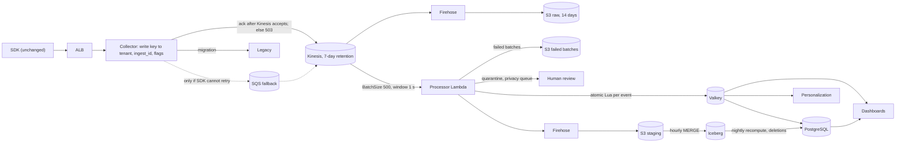

# Engineer 004 - Real-Time Analytics Pipeline

**Brief version: 2026-07** · Fixture `fixtures/event_sample.jsonl`, SHA-256
`1aeb24b415009e89fcf8acb5a178410faf216dc17b16920d9849ecc8bbb24235` [Observed]

**Number source labels** (every number carries one; inputs in the sizing report appendix): [Observed] = brief, fixture, or our run output; [Benchmarked] = AWS/Valkey docs or AWS
Price List API (us-east-1); [Assumed] = to validate; [Estimated] = derived in
`artifact/sizing.py`. **Nothing was deployed or load-tested; performance and cost figures are
calculations.** Detail: [architecture review](design/architecture_review.md),
[migration](design/migration.md), [sizing report](output/sizing_report.md).

## Written answer

### 1. Design and technology

The SDK and hostname stay. An **ECS Fargate collector** behind an ALB authenticates the write
key, stamps `received_at`, and acknowledges only after **Kinesis (provisioned)** accepts every
record. A **Python Lambda** validates, normalizes, deduplicates, and flags events, then makes
one **atomic Valkey Lua call per event** (counters, unique-visitor HLLs, segment buckets).
**Firehose archives everything to S3**; an hourly Athena `MERGE` builds deduplicated
**Iceberg** tables for exports, deletions, and a nightly exact recompute. **PostgreSQL** holds
rollups, the identity graph, the deletion registry, and reconciliation counts.

| Need | Choice | Rejected |
|---|---|---|
| Buffer, replay | Kinesis provisioned, 24 shards [Estimated] | On-demand throttles above 2x the prior peak within 15 min [Benchmarked]; SQS has no replay |
| Processing | Lambda (Python) | Managed Flink: JVM skills the team lacks |
| Live state | Valkey, derived data only | Async replication can lose writes on failover [Benchmarked] |
| Dashboards | Valkey + PostgreSQL rollups | Redshift streaming: sub-5 s undocumented; Timestream for LiveAnalytics closed to new customers |

### 2. Schema, identity, tenancy

Envelope: `event_id`, `tenant_id`, `anonymous_id`, `user_id`, `type`, `ts_original`,
`received_at`, `event_time` (+ source), `properties`, `flags`, `ingest_id`. Event time is the
client `ts` unless invalid or over 2 s [Assumed] after receipt; the raw value is kept. Legacy
field names map permanently. **Tenant** comes from the write key, never the payload; keys,
rows, and S3 prefixes are tenant-scoped. **Identity** links come from SDK events like
`identify` and count as client-asserted: fine for analytics, never for deletion. Privacy
events never link. Segment state is keyed by `anonymous_id` and summed over a person's anons
at evaluation, so arrival order is irrelevant.

### 3. Dashboards, segments, personalization

Each Lua call (keys tagged `{t:<tenant>}`, one slot) checks the dedup marker
`(tenant_id, event_id)` (TTL 8 h, above the 6 h Lambda maximum record age [Assumed]), then
updates minute counters, the hourly HLL (standard error 0.81% [Benchmarked]), and daily rule
buckets. "Viewed pricing 3x in 7 days" sums 7 buckets, bots excluded, client counts ignored. A
segment entry fires once (`SET NX` + unique row); personalization reads state on request. A
tenant too big for one Valkey shard is split by `hash(anonymous_id)`.

### 4. Scale and latency (calculated)

50M events/day is 579 events/s; peak hour 1,157 (2x [Assumed]); **design peak 12,000/s**
(10x peak hour) [Estimated]. At 1 KiB [Assumed], 12 shards suffice at 1,000 records/s or 1
MB/s each [Benchmarked]; 24 give 50% headroom; 4 KiB needs 94 [Estimated]. Lambda requires a
batching window of at least 1 s above `BatchSize` 10 [Benchmarked]; we use 500 and 1 s.
**Receipt-to-dashboard (L1): 2.18 s typical, 3.35 s worst** [Estimated]. SDK-creation latency
(L2) adds SDK buffering and network time, unknown until measured. To load-test: collector
throughput (1,000 requests/s per task [Assumed]), Valkey (96,000 commands/s at peak
[Estimated]), a 10x ramp, L1/L2 canaries.

### 5. Reliability and zero data loss

**Guarantee:** every 2xx-acknowledged event is in Kinesis (replicated across three AZs
[Benchmarked]) and, within 7-day retention [Assumed], is archived, then processed,
quarantined, kept as a failed batch with payload, or suppressed by approved deletion.
Per-record `ingest_id` counts prove it per tenant-hour; a deficit pages. (Our first check,
acknowledged = archived, was wrong: lost responses and retries inflate archived.) **Limit:**
events never acknowledged (closed tab, network loss, an unretried 503) are outside any
server-side guarantee. If the SDK cannot retry, every failed delivery is lost; an SQS fallback
(about $5 per outage-hour [Estimated]) then covers Kinesis failures only.

### 6. Privacy

Deletion needs an authenticated tenant request; SDK privacy events are only queued. It covers
Valkey, PostgreSQL, Iceberg (`DELETE`, `OPTIMIZE`, then `VACUUM`, because `DELETE` alone leaves
rows in old files and snapshots [Benchmarked]), raw, quarantine, and failed-batch S3 objects
via a 14-day lifecycle [Assumed] (removed after expiry with an unspecified delay
[Benchmarked]), RDS backups via 7-day retention [Assumed], and exports via tenant notice. An S3
deletion ledger is replayed after restores; replays drop deleted subjects. Deadlines: GDPR one
month, CCPA 45 days [Benchmarked].

### 7. Migration and rollback

DNS is used once, to insert a passthrough proxy. Then **per-tenant collector flags** (`tee`,
`ack_mode`, `read_source`, `personalization_source`) drive tee, shadow, dashboard cutover, and
acknowledgment cutover. **Legacy acknowledges until each tenant's cutover**, so earlier defects
cannot lose acknowledged events. A tenant passes after 14 days of zero deficits and under 0.5%
unexplained difference from legacy [Assumed]. A flag flip rolls back on any deficit, collector
5xx above 0.1%, or canary p95 above 5 s [Assumed]. Diffing `event_id`s against legacy locates
the 3% loss [Observed] ([brief](https://github.com/ericosiu/beat-claude/blob/main/challenges/engineer-004/brief.md)).

### 8. Cost, trade-offs, scope

New pipeline: **$3,036/month normal, $3,163 with two 10x spikes, $4,279 for a 10x week**
[Estimated] against $50K (verified prices times assumed usage; legacy overlap costs excluded). **Prioritized:** durability of acknowledged events,
operability by 2 engineers, fresh predefined metrics. **Sacrificed:** exactly-once (we use
at-least-once, idempotent writes, nightly recompute), ad hoc real-time queries, per-tenant
infrastructure. **MVP (month 3) excludes** new-pipeline segments, personalization, exports,
Iceberg, automated deletion, the SQS fallback. **More budget:** a real-time analytics database,
Flink, multi-region.

### 9. Fixture analysis

25 lines: 24 parsed, 1 malformed, 1 duplicate, 23 unique, 7 clean [Observed]
(`output/anomaly_report.json`).

| Anomaly [Observed] | Event ids | Handling |
|---|---|---|
| Duplicate (+7.4 s) | `evt-0002` | dedup on tenant + id |
| Malformed JSON | `evt-0020` | quarantine, no repair |
| Legacy schema | `evt-0009` | map fields, stamp receipt |
| Missing tenant | `evt-0011` | quarantine |
| Clock skew (+47.2 s, +65 min) | `evt-0005`, `evt-0006` | use `received_at` |
| Far future (+365 days) | `evt-0016` | use `received_at` |
| Out of order (from skew) | `evt-0017`, `evt-0024` | resolved by the above |
| Suspected bot | `evt-0012`-`evt-0015` | flag; no segments |
| Personal data | `evt-0007` (linked by `evt-0022`) | redact |
| Privacy request | `evt-0017` | escalate; no identity link |
| Client count (3 vs 1 seen) | `evt-0019` | ignore |
| Identity links | `evt-0003`, `evt-0008`, `evt-0022` | graph |

**Not trusted:** `evt-0019`'s `count_today` (client arithmetic); `evt-0017` (unauthenticated:
cannot authorize deletion or prove `anon-77a` is `u-1077`); impossible timestamps on
`evt-0005`, `evt-0006`, `evt-0016`; bot heuristics on `evt-0012`-`evt-0015`; the recovered id
of `evt-0020`. A 25-row synthetic sample [Observed] proves nothing about real rates.

## Architecture diagram

Full diagram: [design/architecture.mmd](design/architecture.mmd). Condensed:

## Submission packet

### Operating artifact

Stdlib Python run from the repository root ([README](README.md)): detector
`artifact/detect_anomalies.py`, 49 tests [Observed] in `artifact/test_detect_anomalies.py`,
cost model `artifact/sizing.py`; outputs in [output/](output/); design in [design/](design/).

### Evidence log

| Claim | Proof | Tier |
|---|---|---|
| Detector output (section 9) | `output/anomaly_report.json` | Tier 3 |
| 49 tests pass [Observed] | `output/run_log.txt` | Tier 3 |
| Defects fixed | `artifact/CHANGELOG.md` + tests | Tier 2 |
| Capacity, latency | `artifact/sizing.py` (unmeasured) | Tier 2 |
| Cost (sourced prices) | `output/sizing_report.md` | Tier 3 |
| Zero loss, migration, privacy | `design/` | Tier 2 |
| Before/after data | none | not claimed |

Defects we found and fixed: privacy events creating identity links; dates detected as phone
numbers; lost timestamp provenance; two weak tests; and, in review, non-atomic Valkey updates,
replays double counting, a wrong reconciliation equation, deleted users returning after
restore, and an invalid batching window. Details and tier caveats:
[architecture review, detailed evidence log](design/architecture_review.md).

### AI usage disclosure

- **Claude (Claude Code desktop agent):** implementation (detector, tests, sizing model), AWS
  research (docs and Price List API), running tests, and drafting these documents.
- **ChatGPT:** ChatGPT helped plan milestones, interpret results, and review the architecture,
  including batching, migration, privacy, and submission-format concerns. Claude verified and
  implemented the changes.
- **Checked by Claude (not by hand):** tests, detector, checksum, validator re-run; prices taken
  from AWS price files; AWS behaviors quoted from fetched docs. **Not verified:** no AWS deployment or load
  test; Athena `MERGE`/`VACUUM` billing [Assumed]; cross-AZ replication charges; diagram rendering.
- **Personal contribution:** I selected Challenge 004, chose to publish the solution
  independently, and directed additional technical and submission reviews. Claude performed the
  implementation and tests.

### Failure handling (What breaks it)

Recovery: failed `PutRecords` entries retry; duplicates hit the dedup marker or `MERGE`; poison
batches go to S3 with payload, page, and are re-injected; Valkey failover triggers a rebuild
([runbook](design/architecture_review.md)). **What breaks it:** an SDK
that cannot retry or mints new ids per retry; events far above 1 KiB [Assumed]; collector or
Valkey capacity below assumption; spikes past 12,000/s [Estimated] (resharding at most doubles
per call [Benchmarked]); a tenant saturating one Valkey slot; legacy lacking a backfill API
after acknowledgment cutover.

### What stays human

Cutover and rollback decisions; verifying privacy requests and approving deletion scope;
telling tenants about exported copies; quarantine triage and new field mappings; identity
conflicts; bot rules; unexplained reconciliation residuals.

### Artifact access

**Repository:** https://github.com/neelraval13/Single-Grain-Engineering-004. Python 3 stdlib only (tested on 3.13.2 [Observed]); no keys;
commands in [README](README.md); fixture unmodified from https://github.com/ericosiu/beat-claude.
